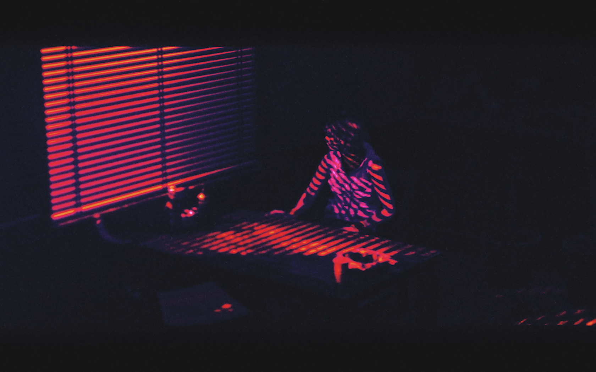
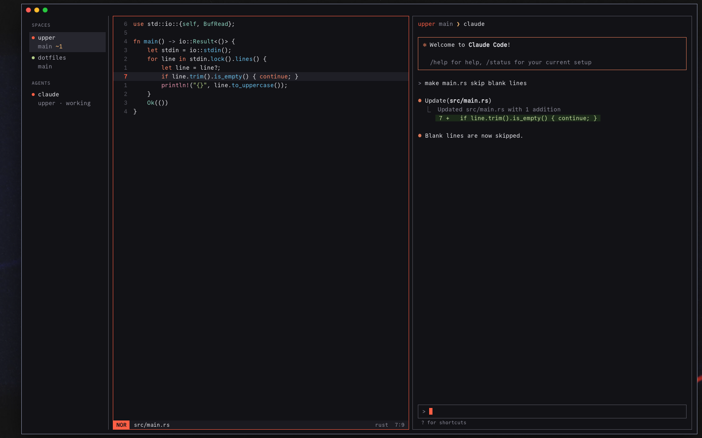
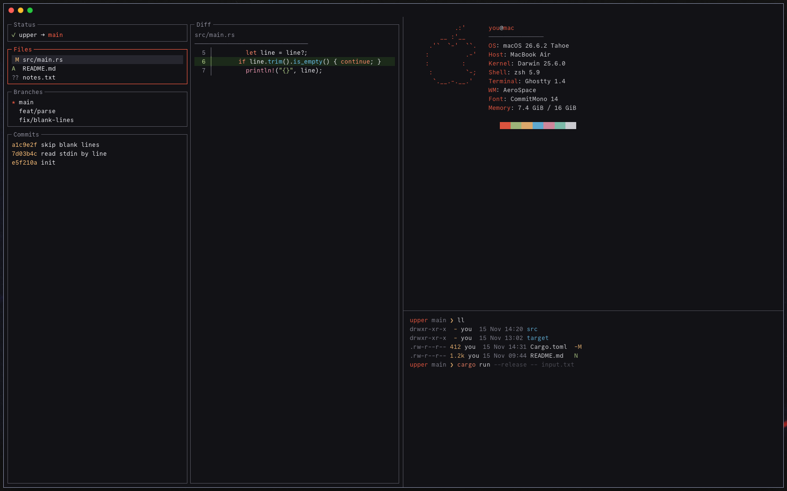
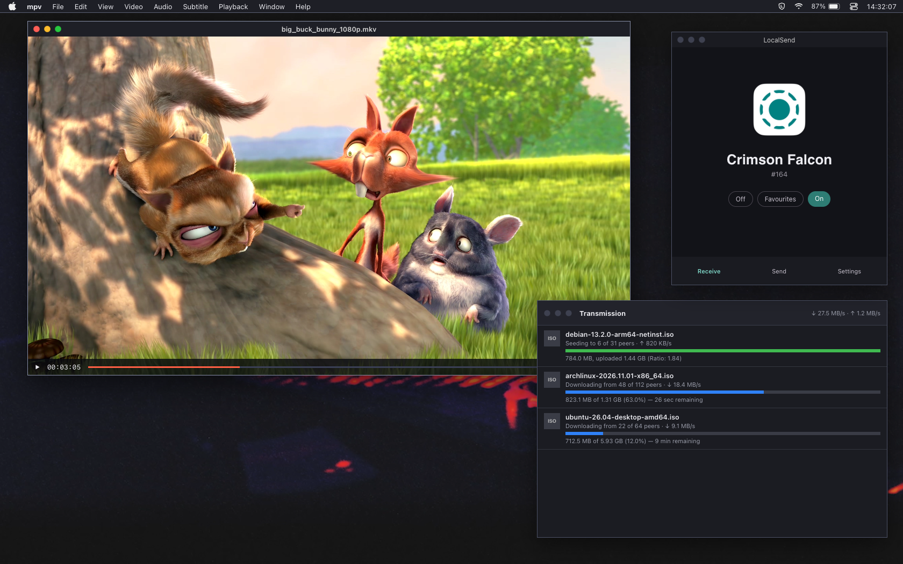

<div align="center">

# dune

**A tight, fast, private macOS — set up in one command.**

Coral on charcoal · square windows · no Liquid Glass · no Apple bloat · no surprise updates



</div>

## Install

On a **fresh** macOS 26 (Tahoe) Mac, Apple silicon:

```bash
git clone https://github.com/MoeDia/dune.git && zsh dune/mac-setup.sh
```

That's it. You'll only ever **click a button or type your password** — the script does the rest, then offers to reboot. Afterwards:

```bash
zsh dune/mac-setup.sh --check     # confirms everything, changes nothing
```

> The included `wallpaper.png` is set automatically — swap in your own to change it, or delete it for plain charcoal.

## What you get

| | |
|---|---|
| **Look** | Dark, coral accent, square window corners, Increase Contrast, no transparency, Commit Mono everywhere |
| **Bars** | Menu bar and Dock auto-hide · Dock on the left, small, smooth · clock with seconds, nothing else |
| **Windows** | [AeroSpace](https://github.com/nikitabobko/AeroSpace) tiling with gaps · AltTab · Maccy clipboard |
| **Terminal** | Ghostty · zsh with suggestions & highlighting · fzf, zoxide, eza, bat, ripgrep, fd, btop, lazygit, delta |
| **Code** | Neovim (no plugins, own theme) · herdr · Claude Code · git · gh · mise · Colima + docker |
| **Browser** | Firefox, themed and trimmed · uBlock Origin + Proton Pass · DRM on · telemetry off |
| **Media** | mpv with every codec, HDR, smooth motion, streaming via yt-dlp · Transmission · LocalSend · Keka |
| **Privacy** | ~115 Apple background services off (Siri, Apple Intelligence, analytics, ads, iCloud sync, Game Mode…) · Apple telemetry blocked |
| **Security** | Firewall + stealth · LuLu outbound firewall · FileVault · no SSH / sharing / guest |
| **Speed** | No animations, More Space display, raised file limits, Spotlight skips caches and build folders |
| **Updates** | Nothing updates by itself. Run `update` when *you* want: apps, tools, malware definitions, macOS list |

## Screens



<table><tr>
<td></td>
<td></td>
</tr><tr>
<td align="center"><sub>lazygit · fastfetch · eza</sub></td>
<td align="center"><sub>mpv · Transmission · LocalSend</sub></td>
</tr></table>

<sub>Renders of the finished setup at 1680×1050 (More Space).</sub>

## Cheat sheet

The essentials — the full one lands in `~/quickstart.html` after setup.

| Keys | |
|---|---|
| `⌥ H J K L` · `⌥⇧ H J K L` | focus · move windows |
| `⌥ 1–5` · `⌥⇧ 1–5` | switch · send to workspace |
| `⌘ D` · `⇧⌘ D` | split terminal right · down |
| `⌃ R` · `cd proj` | fuzzy history · jump to any folder |
| `⇧⌘ C` · `⌥ ⇥` | clipboard history · window switcher |
| `update` | update everything, by hand |

## Make it yours

Everything installed lives in two lists at the top of [`mac-setup.sh`](mac-setup.sh) — `CASKS` and `FORMULAE`. Add, remove, re-run. Personal shell tweaks go in `~/.zshrc.local`, which is never touched.

## Undo

```bash
zsh dune/mac-setup.sh --undo
```

Turns Apple services back on and removes the hosts block, Firefox policies, square corners, Spotlight exclusions and file limits.

## Credits

**Wallpaper** — *Silent Hill 3* (Heather Mason) inspired artwork, found on [Wallhaven #qroy2d](https://wallhaven.cc/w/qroy2d), uploaded by **Cyb3RPh30nix**. The original artist isn't listed there; if it's yours, open an issue and it'll be credited properly or removed. The wallpaper is not covered by the MIT license.

**Video still** — *Big Buck Bunny* © Blender Foundation, [CC BY 3.0](https://creativecommons.org/licenses/by/3.0/).

Fonts, apps and tools belong to their authors — see the links in the table above.

<div align="center"><sub>MIT (code only) · built for a fresh Mac · safe to re-run</sub></div>
